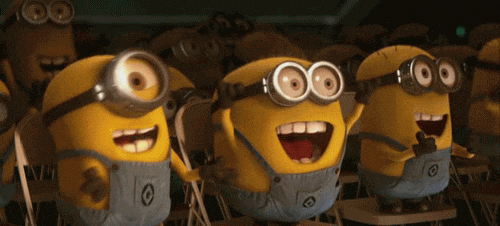
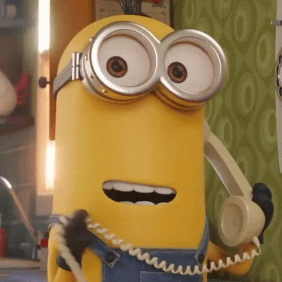

<div align="center">
  
</div>
<h1 align="center">hey there 🐾</h1>

<p align="center">
  <b>🇬🇧 English</b> &nbsp;|&nbsp; <a href="README.tr.md">🇹🇷 Türkçe</a>
</p>

<table>
<tr>
<td width="62%" valign="middle">

<br>
<b>Hello, my name is Seda Nur Öz.</b><br><br>
I am a Software Engineer, graduated from Adana Alparslan Türkeş Science and Technology University (2021–2026), focused on autonomous UAV systems, computer vision, embedded systems and AI-powered applications.<br><br>
As a member of the GİRİFT UAV Team, I reached the finals of both SUAS 2026 and TEKNOFEST 2026, where our team received the Most Original Software Award.<br><br>
I keep my knowledge up to date, research new technologies and learn from experts in the field. <u>You can learn more about me by taking a quick look below.</u>
</td>
<td width="38%" align="center" valign="middle">

</td>
</tr>
</table>

Let's start by saying
``` C
  printf("Hello World!\n");
```


> 🛈 The skills I have acquired since my first step in software engineering, and keep developing due to its dynamic nature.
<br>

| Skills | Details | Skills | Details |
| --- | --- | --- | --- |
|  | Built a real-time object detection system for the SUAS 2026 autonomous UAV with YOLOv8 + TensorRT on NVIDIA Jetson, an automated NodeODM mapping pipeline, and FastAPI backends. |  | Developed the C++17/MAVSDK telemetry backend and Qt 6 desktop interface of P.A.R.S., a multi-UAV ground control station validated in ArduPilot-Gazebo simulation.
|  | Built mobile interfaces for several projects: a nutrition chatbot with calorie tracking and barcode scanning, a campus bike-sharing admin app, and a social music discovery app. |  | Implemented the business logic of my Flutter apps in Dart and handled asynchronous communication with backend services.
|  | Worked on embedded software with Arduino and STM32 during my R&D internship, and built a console-based billing app with file I/O. |  | Built the business logic and data models of a web application using C# and object-oriented programming.
|  | Used ASP.NET Core to build dynamic web pages, handle HTTP requests and set up web application architecture. |  | Used Java to deepen my knowledge of algorithms and data structures through small console projects.
|  | Added interactivity, DOM manipulation and form validation to websites, including the corporate site of Miza Medikal. |  | Built semantic, standards-compliant page structures, such as mizamedikal.com, developed from scratch.
|  | Styled pages and designed layouts with modern CSS3 (Flexbox, Grid). |  | Used Bootstrap's grid system and components to build responsive designs quickly.

<div align="center">
  
</div>
<br>

<div align="center">
  
  
  
  
  
  
  
  
  
  
  
</div>


- 🥇 **TEKNOFEST 2026 Swarm UAV Competition** — Finalist & **Most Original Software Award**
- 🌍 **SUAS 2026 International UAV Competition** — Finalist

<p align="center">
  
</p>


**R&D Summer Intern** — Mahatron (Mahlo Textile Machinery), Bursa · *Jul – Aug 2025*
- Embedded software development on Arduino and STM32 microcontrollers
- Sensor data acquisition and hardware integration

**Software Team Member** — GİRİFT UAV Team, ATÜ, Adana · *2025 – 2026*
- Autonomous UAV software & hardware for SUAS 2026 and TEKNOFEST 2026 Swarm UAV
- Computer vision, embedded system integration and ground control software


| Project | Description | Tech |
| --- | --- | --- |
| **SUAS 2026 – Autonomous UAV Mission System** | Fully autonomous UAV: YOLOv8 optimized with TensorRT for real-time detection on Jetson, a payload drop mechanism for detected targets, and an automated NodeODM pipeline producing two maps (precise + merged). | Python, YOLOv8, TensorRT, Jetson, MAVLink, NodeODM, Docker |
| **TEKNOFEST 2026 Swarm UAV** | Arduino circuit converting S.Bus signals from an HM30 radio into a format Jetson can process and distributing them, so one controller commands three UAVs. | Arduino, S.Bus, Jetson |
| **P.A.R.S. – Smart UAV Swarm Surveillance** | Multi-UAV ground control software with a C++17/MAVSDK telemetry backend, Qt 6 desktop UI and Flutter mobile app; validated in ArduPilot-Gazebo. | C++17, MAVSDK, Qt 6, Flutter, ArduPilot, Gazebo |
| **ATUBIS – RFID Smart Campus Bike System** | Smart lock that opens only with registered student RFID cards; FastAPI REST API + PostgreSQL for station, route and usage data; web and Flutter admin panels. | Python, FastAPI, PostgreSQL, Flutter, RFID, IoT |
| **Nutrition Assistant – AI Chatbot** | Turkish GPT-2 fine-tuned on 83,718 samples, integrated via FastAPI into a Flutter app with calorie tracking and barcode scanning. | Turkish GPT-2, Python, FastAPI, Flutter |
| **MusicGraph – Social Music Discovery** | Graph-based song recommendations by modeling friendships and listening habits in Neo4j (8,200 nodes + relationships). | Neo4j, Python, FastAPI, Flutter |
| **Miza Medikal – Corporate Website** | Corporate website built from scratch for a medical aesthetics company — [mizamedikal.com](https://mizamedikal.com) | HTML, CSS, JavaScript |


<table>
<tr>
<td width="65%" valign="middle">

<a href="https://www.linkedin.com/in/sedanuroz" target="_blank"></a>
<a href="https://www.instagram.com/sedanur_oz_/" target="_blank"></a> 
<a href="mailto:sseedanuroz@gmail.com" target="_blank"></a><br><br>
📌 You can follow me on LinkedIn and review my academic career.<br><br>
📌 You can follow me on Instagram and communicate with me more quickly. <br><br>
📌 You can contact me via Gmail for support, sponsorship, advertising, collaboration or official business.

</td>
<td width="35%" align="right" valign="middle">

</td>
</tr>
</table>

<div align="left">
</div>

<br>
<br>
<picture>
  <source media="(prefers-color-scheme: dark)" srcset="https://raw.githubusercontent.com/sedanuroz/sedanuroz/output/pacman-contribution-graph-dark.svg">
  <source media="(prefers-color-scheme: light)" srcset="https://raw.githubusercontent.com/sedanuroz/sedanuroz/output/pacman-contribution-graph.svg">
  
</picture>


