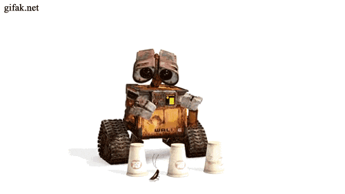

<div align="center">
  
  
  
</div>
<h1 align="center">merhaba 🐾</h1>

<p align="center">
  <a href="README.md">🇬🇧 English</a> &nbsp;|&nbsp; <b>🇹🇷 Türkçe</b>
</p>


> [!IMPORTANT]
> Merhaba, ben Seda Nur Öz.<br>
> Adana Alparslan Türkeş Bilim ve Teknoloji Üniversitesi Yazılım Mühendisliği bölümünden (2021–2026) mezun bir yazılım mühendisiyim. Otonom İHA sistemleri, görüntü işleme, gömülü sistemler ve yapay zekâ destekli uygulamalar üzerine çalışıyorum.
> GİRİFT İHA Takımı'nda SUAS 2026 ve TEKNOFEST 2026 yarışmalarında finale kaldık; TEKNOFEST'te takımımız En Özgün Yazılım Ödülü'nü aldı.
> Bilgimi güncel tutmaya, yeni teknolojileri araştırmaya ve alanında uzman kişilerin deneyimlerinden faydalanmaya önem veriyorum. <u>Aşağıya kısaca göz atarak beni daha yakından tanıyabilirsiniz.</u>

Şöyle başlayalım
``` C
  printf("Hello World!\n");
```


> 🛈 Yazılım mühendisliğinde ilk adımımı attığımdan beri edindiğim ve alanın dinamik yapısı gereği sürekli geliştirdiğim yetkinlikler.
<br>

| Yetkinlik | Detay | Yetkinlik | Detay |
| --- | --- | --- | --- |
|  | SUAS 2026 otonom İHA'sı için NVIDIA Jetson üzerinde YOLOv8 + TensorRT ile gerçek zamanlı hedef tespiti, NodeODM ile otomatik haritalama pipeline'ı ve FastAPI backend'leri geliştirdim. |  | ArduPilot-Gazebo simülasyonunda doğrulanan çoklu İHA yer kontrol yazılımı P.A.R.S.'ın C++17/MAVSDK telemetri backend'ini ve Qt 6 masaüstü arayüzünü geliştirdim.
|  | Kalori takibi ve barkod taramalı beslenme chatbotu, kampüs bisiklet yönetim paneli ve sosyal müzik keşif uygulaması gibi projelerin mobil arayüzlerini geliştirdim. |  | Flutter uygulamalarımın iş mantığını Dart ile kurdum, backend servisleriyle asenkron veri iletişimini yönettim.
|  | Ar-Ge stajımda Arduino ve STM32 üzerinde gömülü yazılım geliştirdim; dosya işlemleri içeren konsol tabanlı bir adisyon uygulaması yazdım. |  | Bir web uygulamasının iş mantığını ve veri modellerini C# ve nesne yönelimli programlama ile oluşturdum.
|  | ASP.NET Core ile dinamik web sayfaları oluşturdum, HTTP isteklerini yönettim ve web uygulamasının mimarisini kurdum. |  | Algoritma ve veri yapıları bilgimi derinleştirmek için Java ile küçük konsol projeleri geliştirdim.
|  | Miza Medikal kurumsal sitesi dahil web projelerinde DOM manipülasyonu ve form doğrulama ile etkileşim ekledim. |  | Sıfırdan geliştirdiğim mizamedikal.com gibi sitelerin anlamsal (semantic) yapısını HTML5 standartlarına uygun kurdum.
|  | Sayfaları modern CSS3 (Flexbox, Grid) ile stilize ettim ve yerleşimlerini tasarladım. |  | Bootstrap'in grid sistemi ve hazır bileşenleriyle hızlıca mobil uyumlu tasarımlar geliştirdim.

<div align="center">
  
</div>
<br>

<div align="center">
  
  
  
  
  
  
  
  
  
  
  
</div>
<br>

## 🏆 Başarılar
- 🥇 **TEKNOFEST 2026 Sürü İHA Yarışması** — Finalist ve **En Özgün Yazılım Ödülü**
- 🌍 **SUAS 2026 Uluslararası İHA Yarışması** — Finalist

## 💼 Deneyim
**Yaz Stajı – Ar-Ge Departmanı** — Mahatron (Mahlo Tekstil Makineleri), Bursa · *Tem – Ağu 2025*
- Arduino ve STM32 mikrodenetleyicileri üzerinde gömülü yazılım geliştirme
- Sensör verisi toplama ve donanım entegrasyonu

**Yazılım Ekibi Üyesi** — GİRİFT İHA Takımı, ATÜ, Adana · *2025 – 2026*
- SUAS 2026 ve TEKNOFEST 2026 Sürü İHA için otonom İHA yazılım ve donanım geliştirme
- Görüntü işleme, gömülü sistem entegrasyonu ve yer kontrol yazılımı

## 🚀 Projeler

| Proje | Açıklama | Teknolojiler |
| --- | --- | --- |
| **SUAS 2026 – Otonom İHA Görev Sistemi** | Tam otonom İHA: Jetson üzerinde TensorRT ile optimize edilmiş YOLOv8 ile gerçek zamanlı hedef tespiti, tespit edilen hedeflere malzeme bırakma mekanizması ve iki harita (kesin + birleşik) üreten NodeODM otomatik haritalama pipeline'ı. | Python, YOLOv8, TensorRT, Jetson, MAVLink, NodeODM, Docker |
| **TEKNOFEST 2026 Sürü İHA** | HM30 telsizinden gelen S.Bus sinyalini Jetson'un işleyebileceği formata çevirip dağıtan Arduino devresi; tek kumandayla üç İHA yönetimi. | Arduino, S.Bus, Jetson |
| **P.A.R.S. – İHA Sürüsü Akıllı Gözetleme Sistemi** | C++17/MAVSDK telemetri backend'i, Qt 6 masaüstü arayüzü ve Flutter mobil uygulamasıyla çoklu İHA takibi yapan yer kontrol yazılımı; ArduPilot-Gazebo'da doğrulandı. | C++17, MAVSDK, Qt 6, Flutter, ArduPilot, Gazebo |
| **ATUBIS – RFID Tabanlı Akıllı Kampüs Bisiklet Sistemi** | Yalnızca kayıtlı öğrenci kartlarıyla açılan akıllı kilit; durak, rota ve kullanım verileri için FastAPI REST API + PostgreSQL; web ve Flutter yönetim panelleri. | Python, FastAPI, PostgreSQL, Flutter, RFID, IoT |
| **Beslenme Asistanı – Yapay Zekâ Chatbotu** | 83.718 örnekle fine-tune edilen Türkçe GPT-2 modeli; FastAPI üzerinden kalori takibi ve barkod tarama içeren Flutter uygulamasına entegre edildi. | Turkish GPT-2, Python, FastAPI, Flutter |
| **MusicGraph – Sosyal Müzik Keşif Uygulaması** | Arkadaşlık ve dinleme alışkanlıklarını Neo4j ile modelleyen graf tabanlı şarkı önerisi (8.200 node + ilişki). | Neo4j, Python, FastAPI, Flutter |
| **Miza Medikal – Kurumsal Web Sitesi** | Medikal estetik firması için sıfırdan geliştirilen kurumsal site — [mizamedikal.com](https://mizamedikal.com) | HTML, CSS, JavaScript |


<a href="https://www.linkedin.com/in/sedanuroz" target="_blank"></a>
<a href="https://www.instagram.com/sedanur_oz_/" target="_blank"></a> 
<a href="mailto:sseedanuroz@gmail.com" target="_blank"></a>
<br>
📌 LinkedIn'den beni takip edip akademik kariyerimi inceleyebilirsiniz.
<br>
📌 Instagram'dan beni takip edip benimle daha hızlı iletişim kurabilirsiniz.
<br>
📌 Destek, sponsorluk, reklam, iş birliği veya resmi işler için Gmail üzerinden ulaşabilirsiniz.

<div align="left">
</div>

<br>
<br>
<picture>
  <source media="(prefers-color-scheme: dark)" srcset="https://raw.githubusercontent.com/sedanuroz/sedanuroz/output/pacman-contribution-graph-dark.svg">
  <source media="(prefers-color-scheme: light)" srcset="https://raw.githubusercontent.com/sedanuroz/sedanuroz/output/pacman-contribution-graph.svg">
  
</picture>


